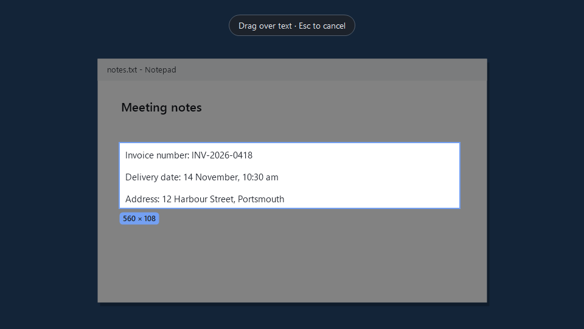
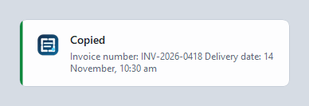

<p align="center">
  
</p>

<h1 align="center">WinTextCapture</h1>

<p align="center">
  <strong>Copy any text you can see on screen.</strong><br>
  Press a hotkey, drag a box over the text, let go: it is on your clipboard.
</p>

<p align="center">
  <a href="https://github.com/ydbilgin/WinTextCapture/releases/latest"></a>
  <a href="https://github.com/ydbilgin/WinTextCapture/releases"></a>
  
  
  <a href="LICENSE"></a>
</p>

<p align="center">
  
</p>

<p align="center">
  <a href="https://github.com/ydbilgin/WinTextCapture/releases/latest"><strong>Download</strong></a>
  &nbsp;·&nbsp; <a href="#install">Install</a>
  &nbsp;·&nbsp; <a href="#how-to-use-it">How to use it</a>
  &nbsp;·&nbsp; <a href="#questions-and-troubleshooting">Troubleshooting</a>
  &nbsp;·&nbsp; <a href="#build-from-source">Build</a>
</p>

## The problem

A lot of text on screen cannot be selected: an error dialog, a screenshot in a chat, a video, a game menu, a
scanned PDF. Typing it out by hand is slow and error-prone. PowerToys has a Text Extractor, but installing all of
PowerToys for one feature is a lot.

WinTextCapture does just this one job. It uses the OCR engine that is already built into Windows, so it works
offline, with no account and no API key.

## What it does

- **One hotkey from anywhere:** `Win + Shift + T`, or pick your own.
- **Drag a box on any screen:** multi-monitor and mixed-DPI aware; `Esc` cancels.
- **Windows OCR, on your PC:** uses `Windows.Media.Ocr`; nothing is uploaded.
- **Choose the OCR language** from the ones installed in Windows, or leave it on automatic.
- **Small and huge selections both work:** tiny text is enlarged before OCR, and very large areas are reduced
  to the size Windows OCR accepts.
- **Clear feedback:** a short toast shows what was copied, or says plainly that no text was found. The
  clipboard is checked before it says "Copied".
- **Quiet:** lives in the tray, one copy at a time, optional start with Windows, Light, Dark or system theme,
  English and Turkish.

## Install

1. Download **`WinTextCapture.exe`** from the [latest release](https://github.com/ydbilgin/WinTextCapture/releases/latest).
2. Put it anywhere, for example `%LOCALAPPDATA%\Programs\WinTextCapture\`, and run it. There is no installer,
   and nothing else to install: the file carries its own .NET runtime.
3. To start it with Windows, open **Settings** from the tray icon and tick **Start with Windows**.

Needs Windows 10 version 2004 (build 19041) or later, or Windows 11.

The pictures here show the current code on `main`, which has a refreshed look (rounded toast card, tidier
settings and menu). The latest release, v1.0.2, works the same but looks slightly older. To get the new look
today, [build from source](#build-from-source); it arrives in the next release.

## How to use it

1. Press `Win + Shift + T`. The screen dims and shows **Drag over text · Esc to cancel**.
2. Drag a box over the text.
3. Let go of the mouse button. A toast shows what was copied.
4. Paste with `Ctrl + V` wherever you like.

You can also double-click the tray icon, or right-click it and choose **Capture now**.

<p align="center">
  
</p>

<p align="center">
  <picture>
    <source media="(prefers-color-scheme: dark)" srcset="docs/toast-copied-dark.png">
    
  </picture>
</p>

**Tray menu:** Capture now, Settings, About, Exit.

**Settings** (right-click the tray icon, then **Settings...**):

<p align="center">
  
  
</p>

- **Capture hotkey:** click the box, then press the keys you want. It takes priority over the Windows shortcut
  for the same keys.
- **Recognition language:** pick the language of the text you capture. For English text in games or apps,
  `English (en-US)` usually beats **Automatic**.
- **Start with Windows**, the interface **Language** (English or Turkish) and the **Theme**.

**Where things are kept**

| What | Where |
|---|---|
| Settings | `%APPDATA%\WinTextCapture\settings.json` |
| Error log | `%APPDATA%\WinTextCapture\error.log` (small, size-limited) |
| Start with Windows | the usual `Run` entry in the current user's registry |

## Questions and troubleshooting

**The hotkey does nothing, or PowerToys opens instead.**
PowerToys Text Extractor uses the same `Win + Shift + T` by default. WinTextCapture usually wins, but not
always. Turn off or change the PowerToys shortcut, or pick another hotkey in WinTextCapture's settings.

**The toast says no text was found.**
Draw the box a little larger than the text, and check the **Recognition language**. Windows can only read
languages whose OCR support is installed: add one under **Windows Settings → Time & language → Language &
region** (the language's optional features include OCR).

**The text comes out wrong.**
Pick the exact language instead of **Automatic**. Very small text is enlarged automatically, but a very wide or
tall box is shrunk to the size Windows OCR accepts; capture a smaller area if the text gets too small.

**The toast says the clipboard did not change.**
Another program was holding the clipboard. WinTextCapture retries a few times and only says "Copied" after it
has checked. Try again.

**Start with Windows points at an old copy.**
Open **Settings** and save with **Start with Windows** ticked: the entry is updated to the copy you are running.
On start, an entry whose program no longer exists is repaired; an entry pointing at another existing copy is
left alone.

**My settings were reset.**
A missing or unreadable settings file falls back to defaults, and a single bad value (for example an invalid
hotkey) falls back on its own while the rest is kept. A failed save keeps the previous settings and hotkey.

## Privacy

WinTextCapture has no network code. The capture, the OCR and the clipboard all stay on your PC. It keeps only
its settings and a small error log in `%APPDATA%\WinTextCapture\`, and a startup entry if you ask for one.

## Build from source

You need the [.NET 9 SDK](https://dotnet.microsoft.com/download/dotnet/9.0) on Windows 10 2004 or later.

```powershell
git clone https://github.com/ydbilgin/WinTextCapture.git
cd WinTextCapture
dotnet run -c Release
```

A single exe that carries its own runtime, like the release:

```powershell
dotnet publish -c Release -r win-x64 --self-contained true -p:PublishSingleFile=true
```

**Tests.** A small test program with no extra packages. Some checks open test windows, so run it where a
window may appear briefly (or on a hidden desktop). It never starts the tray app and never touches the startup
registry entry.

```powershell
dotnet build tests\WinTextCapture.Tests\WinTextCapture.Tests.csproj -c Release
dotnet run --project tests\WinTextCapture.Tests\WinTextCapture.Tests.csproj -c Release --no-build
```

It prints the passed and failed counts and exits with `0` only when everything passed. Live desktop use,
mixed-DPI monitors, OCR accuracy and a busy clipboard still need a person to try.

**Pictures.** The README pictures come from the app itself, drawn off-screen with default settings and a
made-up notepad page:

```powershell
WinTextCapture.exe --screenshot docs/settings-dark.png Dark en
WinTextCapture.exe --screenshot-toast docs/toast-copied-dark.png Dark en copied
```

Other modes: `--screenshot-tray` and `--screenshot-overlay`, with the same theme and language arguments.

**Demo GIF.** `docs/demo.gif` is an animation drawn from `docs/demo/scene.html`; re-render it with
`node docs/demo/render.mjs`. See [docs/demo/README-demo.md](docs/demo/README-demo.md).

## How the code is laid out

| File | Job |
|---|---|
| `TrayApplicationContext.cs` | tray icon, menu, settings, starting a capture, showing the result |
| `KeyboardHook.cs`, `KeyboardHookState.cs` | the global hotkey and its testable state machine |
| `OverlayForm.cs` | the dimmed screen, the selection, OCR and the clipboard write |
| `OcrImagePreprocessor.cs` | enlarges small selections and limits large ones before OCR |
| `ClipboardWriter.cs` | retries and checks clipboard writes |
| `CaptureMessageFormatter.cs`, `ToastForm.cs` | the toast text and card |
| `Settings.cs`, `SettingsForm.cs` | loading, checking and saving preferences, and the settings window |
| `AutoStartDecision.cs`, `AutoStart.cs` | the start-with-Windows entry |
| `CrashLog.cs`, `CrashLogger.cs` | the size-limited error log |
| `tests/WinTextCapture.Tests` | the test program |

## License

[MIT](LICENSE)
