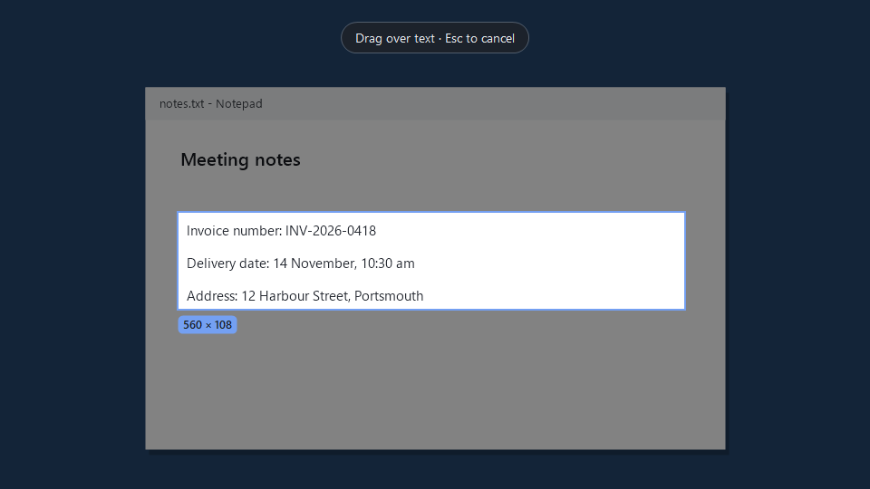
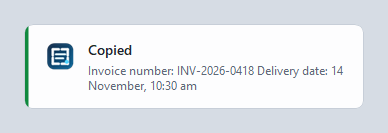
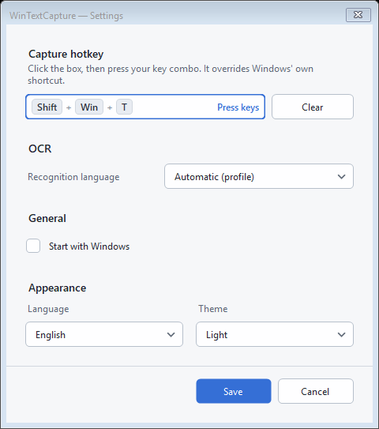
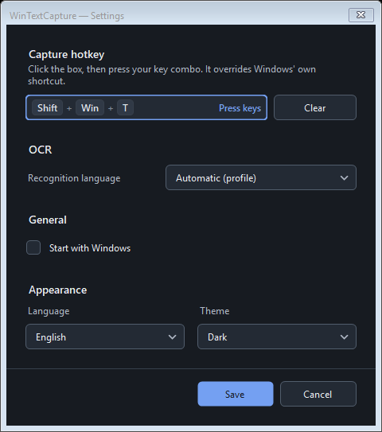
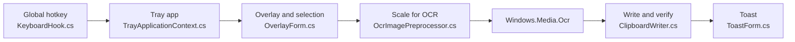

<!-- showcase:hero:start (generated from docs/showcase/showcase.yml) -->
<p align="center"></p>
<h1 align="center">WinTextCapture</h1>
<p align="center">
  <strong>Copy any text you can see on screen.</strong><br>
  A small Windows tray app that reads text from any part of the screen with the OCR built into Windows.
</p>
<p align="center">
  <a href="https://github.com/ydbilgin/WinTextCapture/releases/latest"></a>
  
  <a href="LICENSE"></a>
</p>
<p align="center">
  <kbd>Win</kbd> + <kbd>Shift</kbd> + <kbd>T</kbd> &nbsp;→&nbsp; drag a box &nbsp;→&nbsp; <kbd>Ctrl</kbd> + <kbd>V</kbd>
</p>
<p align="center">
  <br>
  <sub>Illustration of the behaviour, not a screen recording. The toast and settings window in it are the app&#x27;s own rendered pictures. <a href="docs/demo/README-demo.md">How it is drawn</a>.</sub>
</p>
<p align="center">
  <a href="https://github.com/ydbilgin/WinTextCapture/releases/latest"><strong>Download</strong></a> &nbsp;·&nbsp;
  <a href="#features">Features</a> &nbsp;·&nbsp;
  <a href="#compared-with-the-windows-options">Compared</a> &nbsp;·&nbsp;
  <a href="#install">Install</a> &nbsp;·&nbsp;
  <a href="#use">Use</a> &nbsp;·&nbsp;
  <a href="#questions-and-troubleshooting">FAQ</a> &nbsp;·&nbsp;
  <a href="#build-from-source">Build</a> &nbsp;·&nbsp;
  <a href="#türkçe">Türkçe</a>
</p>
<!-- showcase:hero:end -->

A lot of text on screen cannot be selected: an error dialog, a screenshot in a chat, a video, a game menu, a
scanned PDF. Typing it out is slow and error-prone. WinTextCapture does this one job, offline, with no account,
no API key and no network code.

## Features

<!-- showcase:features:start (generated from docs/showcase/showcase.yml) -->
<table>
<tr>
<td width="50%" valign="top">

**One hotkey from anywhere**<br>
`Win + Shift + T` by default, or any key with at least one of Ctrl, Alt, Shift, Win. Double-click the tray icon or use **Capture now** as well.

</td>
<td width="50%" valign="top">

**Drag a box on any screen**<br>
The overlay covers every monitor and is per-monitor DPI aware. It shows the box size in pixels; `Esc` cancels.

</td>
</tr>
<tr>
<td width="50%" valign="top">

**Windows OCR, on your PC**<br>
Uses `Windows.Media.Ocr`. The selection is read locally and nothing is uploaded.

</td>
<td width="50%" valign="top">

**Pick the OCR language**<br>
**Automatic** (your Windows profile languages) or any OCR language installed in Windows.

</td>
</tr>
<tr>
<td width="50%" valign="top">

**Small and huge selections**<br>
A selection is enlarged 2–3x before OCR (3x for short ones), within the size Windows OCR accepts; very large ones are scaled down to fit.

</td>
<td width="50%" valign="top">

**Checked clipboard**<br>
The text is written, read back and compared, with a few retries if another app holds the clipboard. Copied means it is really there.

</td>
</tr>
<tr>
<td width="50%" valign="top">

**Clear feedback**<br>
A toast shows the first words of what was copied, or says plainly that no text was found.

</td>
<td width="50%" valign="top">

**Quiet tray app**<br>
One copy per user session, optional start with Windows, Light / Dark / system theme, English and Turkish interface.

</td>
</tr>
</table>
<!-- showcase:features:end -->

## Compared with the Windows options

<!-- showcase:comparison:start (generated from docs/showcase/showcase.yml) -->
Two Microsoft tools already read text from the screen, and both are good. WinTextCapture is a smaller, single-purpose alternative, not a replacement for either.

| | PowerToys Text Extractor | Snipping Tool text actions (Windows 11) | WinTextCapture |
| --- | --- | --- | --- |
| **How you use it** | `Win + Shift + T` (default), drag a box, the text goes to the clipboard | Take a snip, open **Text actions**, then copy all or part of the text | `Win + Shift + T` (changeable), drag a box, the text goes to the clipboard |
| **What you install** | PowerToys, a suite of many utilities | Nothing; it comes with Windows 11 | One portable exe that runs from the tray |
| **Does differently** | Part of a larger toolkit you may already use | You keep the screenshot and can save, mark up or share it | Only this job; a toast confirms what was copied after checking the clipboard |
| **Pick it when** | You already run PowerToys | You want the image too, or prefer not to add an app | You want just text capture, without the rest of PowerToys |

PowerToys Text Extractor uses the same default hotkey. If you run both, change the shortcut in one of them (see [the FAQ](#questions-and-troubleshooting)).
<!-- showcase:comparison:end -->

## Install

1. Download **`WinTextCapture.exe`** from the [latest release](https://github.com/ydbilgin/WinTextCapture/releases/latest).
2. Put it anywhere, for example `%LOCALAPPDATA%\Programs\WinTextCapture\`, and run it. There is no installer; the
   release exe carries its own .NET runtime.
3. To start it with Windows, open **Settings** from the tray icon and tick **Start with Windows**.

Needs Windows 10 version 2004 (build 19041) or later, or Windows 11, x64. Windows SmartScreen may warn about a new
download from a small publisher; choose **More info → Run anyway** if you trust the file.

The pictures here show the current code on `master`, which has a refreshed look (rounded toast card, themed
settings and menu). The latest release, v1.0.2, works the same but looks slightly older; the new look arrives in
the next release, or [build from source](#build-from-source) today.

## Use

1. Press `Win + Shift + T`. The screen dims and shows **Drag over text · Esc to cancel**.
2. Drag a box over the text and let go. A toast shows what was copied.
3. Paste with `Ctrl + V` wherever you like.

<p align="center">
  
</p>
<p align="center">
  <picture>
    <source media="(prefers-color-scheme: dark)" srcset="docs/toast-copied-dark.png">
    
  </picture><br>
  <sub>Rendered by the app's own <code>--screenshot</code> modes, with default settings and a made-up page.</sub>
</p>

**Tray menu:** Capture now, Settings..., About, Exit. **Settings:**

<!-- showcase:gallery:start (generated from docs/showcase/showcase.yml) -->
<table>
<tr>
<td width="50%" valign="top" align="center">
<br>
<sub>Settings, Light theme</sub>
</td>
<td width="50%" valign="top" align="center">
<br>
<sub>Settings, Dark theme</sub>
</td>
</tr>
</table>
<!-- showcase:gallery:end -->

- **Capture hotkey:** click the box, then press the keys you want. It takes priority over a Windows shortcut on
  the same keys.
- **Recognition language:** the language of the text you capture. For English text in games or apps,
  `English (en-US)` usually beats **Automatic**.
- **Start with Windows**, the interface **Language** (English or Turkish) and the **Theme**.

| What | Where |
|---|---|
| Settings | `%APPDATA%\WinTextCapture\settings.json` |
| Error log | `%APPDATA%\WinTextCapture\error.log` (capped at 256 KB) |
| Start with Windows | a `WinTextCapture` value under `HKCU\Software\Microsoft\Windows\CurrentVersion\Run` |

## Questions and troubleshooting

**Does anything leave my PC?**
No. There is no network code. The capture, the OCR and the clipboard stay on your PC. While OCR runs, the
selection is written to a temporary PNG in `%TEMP%` and deleted right after.

**Does it need admin rights?** No. Everything it writes is per user: the files above and the current user's
`Run` entry.

**How do I uninstall it?** Untick **Start with Windows** in Settings (this removes the `Run` entry), choose
**Exit** from the tray menu, then delete the exe and `%APPDATA%\WinTextCapture\`.

**The hotkey does nothing, or PowerToys opens instead.**
PowerToys Text Extractor uses the same `Win + Shift + T` by default. WinTextCapture usually wins, but not
always. Turn off or change the PowerToys shortcut, or pick another hotkey in WinTextCapture's settings.

**The toast says no text was found.**
Draw the box a little larger than the text, and check the **Recognition language**. Windows can only read
languages whose OCR support is installed: add one under **Windows Settings → Time & language → Language &
region** (the language's optional features include OCR).

**The text comes out wrong.**
Pick the exact language instead of **Automatic**. Small text is enlarged automatically, but a very wide or tall
box is shrunk to the size Windows OCR accepts; capture a smaller area if the text gets too small.

**The toast says the clipboard did not change.**
Another program was holding the clipboard. WinTextCapture retries a few times and only says "Copied" after it
has checked. Try again.

**Start with Windows points at an old copy, or my settings were reset.**
Save Settings with **Start with Windows** ticked to point the entry at the copy you are running; on start, an
entry whose program no longer exists is repaired. A missing or unreadable settings file falls back to defaults,
and a single bad value (for example an invalid hotkey) falls back on its own while the rest is kept.

## How it works



A low-level keyboard hook watches for the capture combination. The overlay freezes a picture of all monitors,
you drag a box, and that part of the picture is scaled and passed to Windows OCR. The text is written to the
clipboard, read back to confirm it, and summarised in a toast. Settings, start-with-Windows and the error log
live in `Settings.cs`, `AutoStart.cs` and `CrashLogger.cs`.

## Build from source

You need the [.NET 9 SDK](https://dotnet.microsoft.com/download/dotnet/9.0) on Windows 10 2004 or later.

```powershell
git clone https://github.com/ydbilgin/WinTextCapture.git
cd WinTextCapture
dotnet run -c Release

# a single exe that carries its own runtime, like the release
dotnet publish -c Release -r win-x64 --self-contained true -p:PublishSingleFile=true
```

**Tests** are a small console program with no extra packages. Some checks open test windows briefly; it never
starts the tray app and never touches the startup registry entry. It exits with `0` only when everything passed.

```powershell
dotnet build tests\WinTextCapture.Tests\WinTextCapture.Tests.csproj -c Release
dotnet run --project tests\WinTextCapture.Tests\WinTextCapture.Tests.csproj -c Release --no-build
```

**Pictures.** The PNGs in `docs/` come from the app itself, drawn off-screen:
`WinTextCapture.exe --screenshot docs/settings-dark.png Dark en`, `--screenshot-toast`, `--screenshot-tray` and
`--screenshot-overlay` take the same theme and language arguments. The illustration `docs/demo.gif` is re-rendered
with `node docs/demo/render.mjs` (see [docs/demo/README-demo.md](docs/demo/README-demo.md)).

## Contributing, security, license

Bug reports and small, focused pull requests are welcome: see [CONTRIBUTING.md](CONTRIBUTING.md). Please report
security problems privately as described in [SECURITY.md](SECURITY.md). Released under the [MIT License](LICENSE).

## Türkçe

**WinTextCapture**, ekranda gördüğünüz ama seçemediğiniz metni (hata pencereleri, ekran görüntüleri, videolar,
oyun menüleri, taranmış PDF'ler) panoya kopyalayan küçük bir Windows tepsi uygulamasıdır. Windows'un kendi OCR
motorunu kullanır; internet bağlantısı, hesap ya da API anahtarı gerekmez.

- **Kurulum:** [Son sürümden](https://github.com/ydbilgin/WinTextCapture/releases/latest) `WinTextCapture.exe`
  dosyasını indirip çalıştırın. Kurulum sihirbazı yoktur, .NET kurmanız gerekmez.
- **Kullanım:** `Win + Shift + T` tuşlarına basın, metnin üzerinden bir kutu sürükleyin, bırakın; metin panodadır.
  `Esc` iptal eder.
- **Ayarlar:** Tepsi simgesine sağ tıklayıp **Ayarlar...** ile kısayolu, OCR dilini, Windows ile başlatmayı, tema ve
  arayüz dilini (Türkçe / İngilizce) değiştirebilirsiniz.
- Ayrıntılar için: [Özellikler](#features) · [Sorular](#questions-and-troubleshooting) · [Kaynaktan derleme](#build-from-source)
