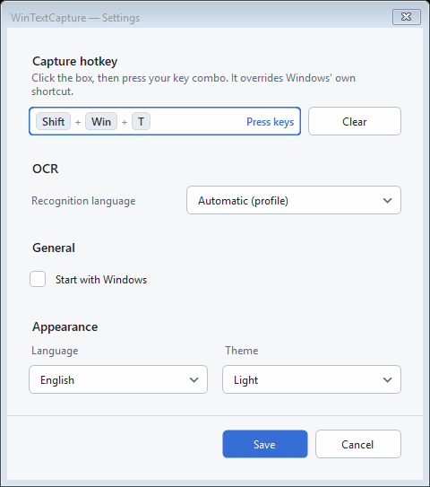
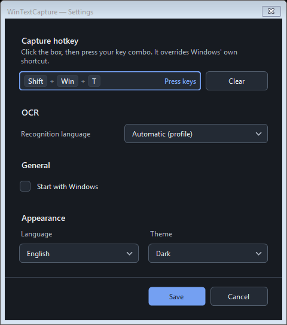

<p align="center">
  
</p>

<h1 align="center">WinTextCapture 📋🔎</h1>

<p align="center">
  A lightweight Windows tray utility for copying text from anywhere on screen.<br>
  Press the hotkey, drag over text, release — the recognized text is on your clipboard.
</p>

<p align="center">
  <a href="https://github.com/ydbilgin/WinTextCapture/releases/latest"></a>
  <a href="https://github.com/ydbilgin/WinTextCapture/releases"></a>
  
  
  <a href="LICENSE"></a>
</p>

<p align="center">
  
  
</p>

The theme examples show an earlier settings layout. The current layout places Save and Cancel below the appearance controls.

Press the hotkey, drag over text, release the mouse button, and the recognized text is copied to the clipboard. It is intended as a lightweight alternative to installing all of PowerToys just for Text Extractor — native Windows OCR, no cloud, no account.

## Features

- 🔎 **Native Windows OCR** — uses `Windows.Media.Ocr`, fully offline. No cloud, no account, no API key.
- ⌨️ **Global hotkey** — press `Win + Shift + T` from anywhere, drag a box over the text, release, done.
- 🖥️ **Multi-monitor selection overlay** — grab text on any screen; mixed-DPI aware.
- 🌍 **OCR language picker** — choose from the OCR languages installed in Windows, ideal for non-English text.
- 🔬 **Image preprocessing** — upscales tiny selections and bounds oversized captures to the Windows OCR image limit.
- 📋 **Reliable clipboard** — every write is retried and verified, so you never paste stale text.
- 🔔 **Toast feedback** — a short preview of what was copied, or a clear note when nothing readable was found.
- 🚀 **Quiet & light** — optional start with Windows, single instance, tray-only, and light / dark / system themes.

## Install

### Option A — download a release
1. Grab the latest **`WinTextCapture.exe`** from the **[Releases page](https://github.com/ydbilgin/WinTextCapture/releases/latest)**.
2. Run it — it lives in the system tray, no installer. The build is standalone, so no .NET runtime is required.

### Option B — build from source
You'll need the **.NET 9 SDK** on Windows 10 version 2004 (build 19041) or later, or Windows 11.

```powershell
git clone https://github.com/ydbilgin/WinTextCapture.git
cd WinTextCapture
dotnet build -c Release

# standalone single-file exe (bundles the runtime)
dotnet publish -c Release -r win-x64 --self-contained true -p:PublishSingleFile=true
```

## Usage

1. Start `WinTextCapture.exe`.
2. Use `Win + Shift + T`.
3. Drag a rectangle over the text you want to copy.
4. Release the mouse button.
5. Paste with `Ctrl + V`.

If OCR succeeds, the app shows a small toast such as `Copied: ...`. If no readable text is found or the clipboard does not change, the toast says so explicitly.

Very wide or tall selections are downsized to Windows OCR's maximum image dimension. Capture a smaller region if resizing makes the text too small.

## OCR Languages

WinTextCapture uses Windows' built-in OCR engine. It can only recognize languages that have OCR support installed in Windows.

Open **Settings** from the tray menu and choose the OCR language that matches the text you capture. For games or apps using English UI text, selecting `English (en-US)` is usually better than `Automatic`.

To see or install OCR language packs on Windows, use Windows language settings or the PowerShell capability commands documented by Microsoft for Windows OCR language packs.

## Hotkey Notes

The default hotkey is `Win + Shift + T`.

The app uses a low-level keyboard hook so it can consume the shortcut before the Windows or PowerToys handler in most normal cases. If PowerToys Text Extractor is also enabled with the same shortcut, hook order can still cause conflicts. Disable or change the PowerToys Text Extractor shortcut if both tools are installed.

## Settings and diagnostics

Settings are stored in `%APPDATA%\WinTextCapture\settings.json`. Missing or unreadable files use defaults. Null preferences, malformed OCR language tags, and invalid shortcuts also use defaults while valid preferences remain intact.

The Windows startup registry entry controls whether the app starts with Windows. Startup repairs an entry whose executable is missing. It preserves an entry pointing to another existing copy. Saving an explicit startup choice applies it to the current copy.

Handled UI exceptions, startup-setting failures, and fatal exceptions are recorded in `%APPDATA%\WinTextCapture\error.log`. Capture failures currently show a generic error and may lack an exception entry.

## Testing

The dependency-free executable test harness covers hotkey state, Unicode previews, clipboard retry decisions, OCR sizing, settings recovery, settings layout, startup decisions, and diagnostic formatting.

Tests keep settings forms invisible and use clipboard delegates and settings fixtures inside the test output directory. They do not launch the tray app or change the Windows startup registry.

```powershell
dotnet build tests\WinTextCapture.Tests\WinTextCapture.Tests.csproj -c Release --disable-build-servers -m:1 -warnaserror -p:UseSharedCompilation=false
dotnet run --project tests\WinTextCapture.Tests\WinTextCapture.Tests.csproj -c Release --no-build
```

The runner reports every failure and prints the passed and failed case counts. Success requires a positive passed count, no failures, and exit code `0`.

Desktop interaction, mixed-DPI monitor behavior, recognition accuracy, and real clipboard contention still require separate integration checks.

## Project Structure

- `TrayApplicationContext.cs` owns the tray icon, menu, settings, capture trigger, and result feedback.
- `KeyboardHook.cs` installs the global low-level keyboard hook.
- `KeyboardHookState.cs` contains the testable hotkey state machine.
- `OverlayForm.cs` handles screen capture, selection, OCR, and clipboard write flow.
- `OcrImagePreprocessor.cs` upscales small selections and bounds oversized images before OCR.
- `ClipboardWriter.cs` retries and verifies clipboard writes.
- `CaptureMessageFormatter.cs` creates result messages and preserves whole Unicode text elements in short previews.
- `Settings.cs` loads, validates, and saves user preferences.
- `AutoStartDecision.cs` isolates startup-entry decisions from registry access.
- `CrashLog.cs` formats diagnostics, while `CrashLogger.cs` persists a bounded local log.
- `SettingsForm.cs` provides the small Windows Forms settings UI.
- `tests/WinTextCapture.Tests` contains lightweight regression tests without external test packages.

Maintenance documentation reviewed on 2026-10-06.

## License

[MIT](LICENSE)
